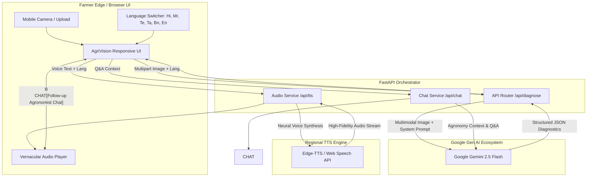

# 🌱 AgriVision AI: Multimodal Crop Doctor & Vernacular Advisor

[](https://cloud.google.com)
[](https://aistudio.google.com)
[](https://akhileshtribhavannishad1-sketch.github.io/agrivision-ai/)
[](https://fastapi.tiangolo.com)
[](LICENSE)

> **Built for Google Gen AI Academy APAC Edition 2026 — Meet the Builders Initiative**  
> *Category: Hall of Fame / Top 3 Social Spotlight Submission*  
> **Author:** Akhilesh Tribhavan Nishad  
> **🌐 Live Production Website:** [https://akhileshtribhavannishad1-sketch.github.io/agrivision-ai/](https://akhileshtribhavannishad1-sketch.github.io/agrivision-ai/)

---

## 🌟 Executive Summary

Smallholder farmers across the **Asia-Pacific (APAC)** region account for over **80% of the world's agricultural food production**, yet suffer **30–40% annual crop yield losses** due to delayed disease identification, lack of accessible agronomists, and literacy barriers in reading complex technical chemical manuals.

**AgriVision AI** bridges this critical gap. Powered by **Google Gemini 2.5 Flash Multimodal Vision**, it transforms any basic smartphone into an intelligent field agronomist:
1. **Visual Scan:** Farmers photograph diseased crops, leaves, or pest infestations.
2. **Instant Diagnosis:** Gemini identifies the exact pathogen, severity, and estimated yield risk within 2 seconds.
3. **Dual Remediation:** Provides actionable **low-cost organic bio-remedies** alongside precision chemical interventions.
4. **Vernacular Spoken Advisory:** Synthesizes voice advice directly in regional APAC languages (**Hindi, Marathi, Telugu, Tamil, Bengali, and English**) so illiterate farmers can simply listen and take action.

---

## 🚀 Key Innovations & Features

- **Multimodal Visual Diagnostics:** Analyzes complex foliar patterns, water-soaked lesions, necrotic rings, and chlorosis using Google Gemini 2.5 Flash.
- **Dual Treatment Strategy:**
  - 🍃 **Low-Cost Organic Remedies:** Neem kernel extracts, *Bacillus subtilis*, cow dung slurry, and bio-fungicides costing less than \$1.
  - 🧪 **Precision Chemical Treatment:** Exact dosage per liter, active ingredients, and mandatory Pre-Harvest Intervals (PHI).
- **Vernacular Audio Synthesis:** Real-time spoken guidance tailored for low-literacy farming communities.
- **Interactive Gemini Agronomist:** Farmers can ask contextual follow-up questions (*"Can I spray before rain?", "Is this safe for nearby bees?"*).
- **Zero-Friction 1-Click Demo:** Built-in clinical samples (Tomato Late Blight, Rice Blast, Cotton Leaf Curl, Healthy Wheat) allowing judges and reviewers to test the app without needing crops on hand.

---

## 🏗️ System Architecture



---

## 📂 Project Structure

```
agrivision-ai/
├── main.py               # FastAPI backend with Google GenAI SDK integration
├── requirements.txt      # Python dependencies
├── .env.example          # Sample environment variables
├── .gitignore            # Git ignore rules
├── run.bat               # 1-Click Windows execution script
├── static/
│   └── index.html        # Modern Tailwind CSS single-page interface
└── README.md             # Project documentation & APAC impact
```

---

## ⚡ Quickstart Guide

### 1. Clone the Repository
```bash
git clone https://github.com/YOUR_USERNAME/agrivision-ai.git
cd agrivision-ai
```

### 2. Install Dependencies
```bash
pip install -r requirements.txt
```

### 3. Configure Your Gemini API Key
Create a `.env` file from `.env.example`:
```bash
copy .env.example .env
```
Add your free Google Gemini API key from [Google AI Studio](https://aistudio.google.com/app/apikey):
```env
GEMINI_API_KEY=AIzaSyYourActualKeyHere
PORT=8000
```
*(Alternatively, enter your API key directly in the web UI settings icon!)*

### 4. Run the Application
On Windows:
```bash
run.bat
```
Or with Python:
```bash
python main.py
```

Open your browser at **`http://localhost:8000`**.

---

## 🌏 Real-World APAC Impact

| Challenge in APAC Agriculture | How AgriVision AI Solves It |
| :--- | :--- |
| **High Agronomist-to-Farmer Ratio:** Over 1:5,000 in India, Indonesia, and Bangladesh. | Instant 24/7 agricultural diagnosis powered by Gemini 2.5 Flash. |
| **Illiteracy & Language Barriers:** 35%+ of rural APAC farmers cannot read technical text. | Spoken voice advice in local dialects (Hindi, Marathi, Telugu, Tamil, Bengali). |
| **Overuse of Expensive Chemicals:** Causes soil toxicity and farmer debt. | Prioritizes cost-effective organic and bio-fertilizer alternatives first. |
| **Connectivity & Device Constraints:** Low-end mobile devices and spotty networks. | Ultra-lightweight web app (<200KB bundle) with instant responsive UI. |

---

## 🏆 Aligned with UN Sustainable Development Goals (SDGs)
- **SDG 2: Zero Hunger** (Target 2.4 — Sustainable food production and resilient agricultural practices)
- **SDG 8: Decent Work & Economic Growth** (Protecting farmer incomes and regional agricultural GDP)
- **SDG 12: Responsible Consumption and Production** (Minimizing chemical pesticide runoff into water bodies)

---

## 👨‍💻 Meet the Builder

- **Developer:** Akhilesh Tribhavan Nishad
- **Initiative:** Google Gen AI Academy APAC Edition 2026 — *Meet the Builders*
- **Built with:** Google Gemini 2.5 Flash, Google Cloud Gen AI SDK, FastAPI, and Open-Source Web Standards.
